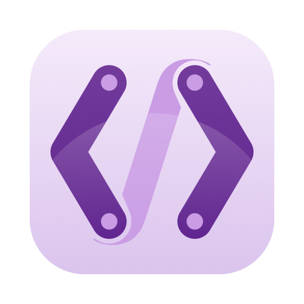
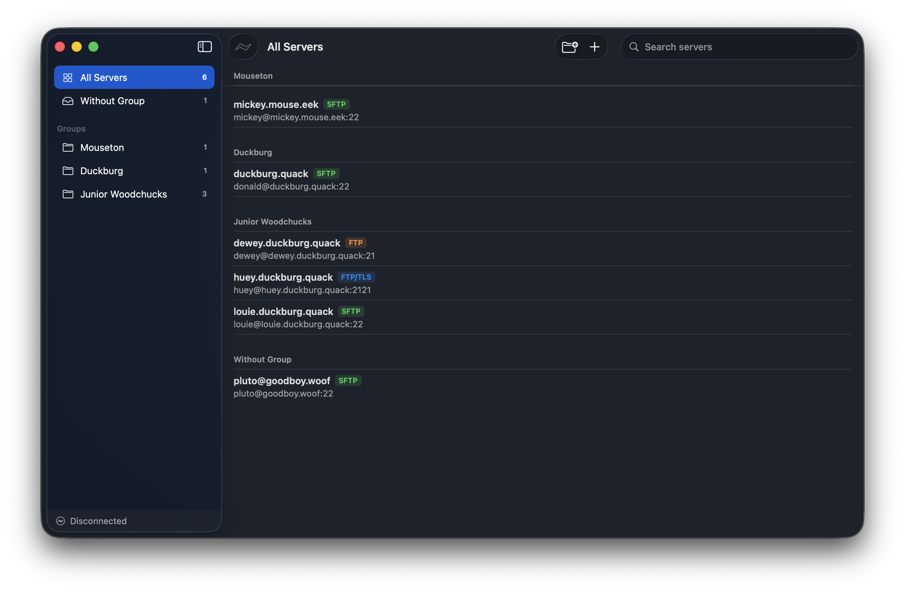
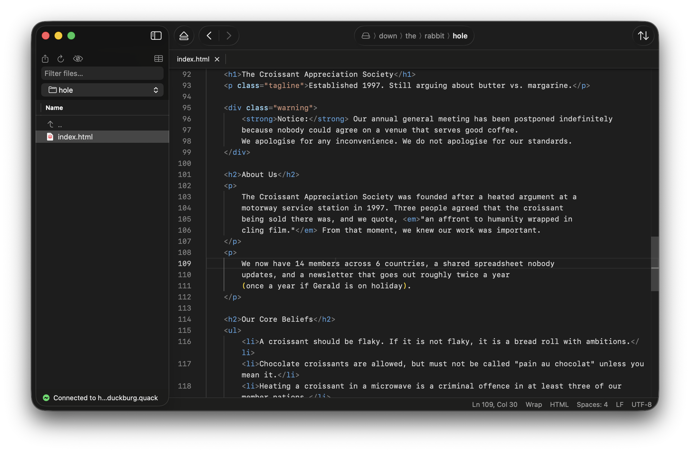
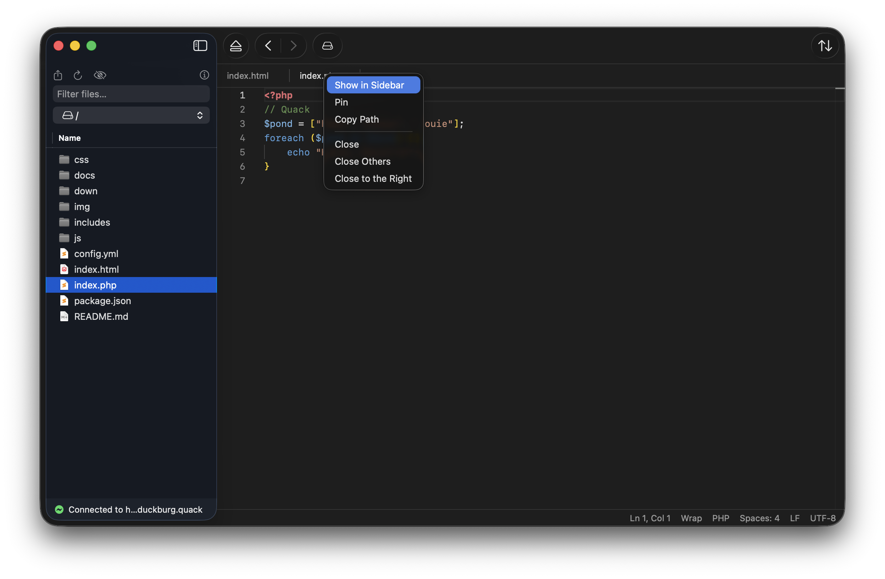
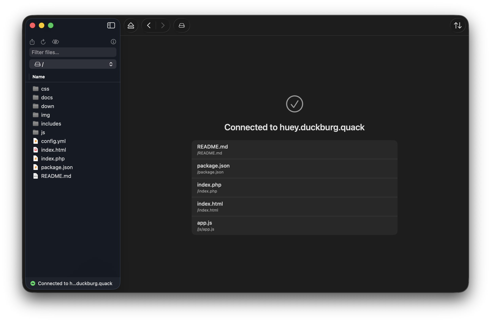

# Edith for macOS

A native macOS SFTP/FTP client for live remote file editing, rebuilt in
Swift and SwiftUI from [Edith for Linux](https://github.com/mkay/edith).
The editor is Monaco, hosted in a `WKWebView`.

**[Download the latest release](https://github.com/mkay/edith-mac/releases/latest)**











## Installing

Download `Edith-<version>.dmg` from the [latest release](https://github.com/mkay/edith-mac/releases/latest)
and drag Edith into Applications. It needs macOS 15 or later, on Apple Silicon or Intel.

Edith isn't notarised by Apple, so the first launch needs one extra step:

1. Open Edith. macOS says it can't verify that Edith is free of malware and doesn't open
   it. The dialog only offers **Done** and **Move to Bin**; choose **Done**.
2. Open **System Settings → Privacy & Security**, scroll to the bottom, and click
   **Open Anyway** next to the message about Edith. Enter your password. The button
   only appears for about an hour after the blocked attempt, so try opening Edith again
   if it's missing.

If you prefer the Terminal, this clears the flag instead:

```sh
xattr -dr com.apple.quarantine /Applications/Edith.app
```

After that it opens normally. Updates arrive through **Edith → Check for Updates…**
(and automatically, if you allow it), signed with Edith's own update key, and don't
need this step again.

Coming from the Linux app? Use **Export Servers…** there (with passwords, if you
like), then **File → Import Servers…** here. A FileZilla `sitemanager.xml` works too.

## Layout

| Path | What |
|---|---|
| `App/` | The SwiftUI app target |
| `Packages/EdithCore/` | Models, config, Keychain, known_hosts, SFTP client, transfer queue. No UI imports. |
| `Packages/EdithEditor/` | Monaco host: `WKWebView`, `edith://` scheme handler, `bridge.js` |
| `Spikes/SFTPSpike/` | libssh2 vs Citadel comparison ([results](Spikes/SFTPSpike/RESULTS.md)) |
| `project.yml` | XcodeGen spec. `Edith.xcodeproj` is generated, not checked in. |

## Building

Requires Xcode 26 or later, plus [XcodeGen](https://github.com/yonaskolb/XcodeGen)
(`brew install xcodegen`).

```sh
scripts/fetch-monaco.sh      # Monaco, Emmet, terser, csso from the npm registry
scripts/build-libssh2.sh     # libssh2 + OpenSSL as a universal xcframework (~2 min)
xcodegen generate
open Edith.xcodeproj
```

Tests:

```sh
(cd Packages/EdithCore && swift test)
(cd Packages/EdithEditor && swift test)
```

The SFTP tests start a throwaway OpenSSH server (`/usr/sbin/sshd`) on a free
loopback port, running as you with key auth only, and stop it when the run
ends. They read and write only inside a temp directory.

## Translations

English and German. The strings live in String Catalogs: `App/Localizable.xcstrings`
for the app and `Packages/EdithCore/Sources/EdithCore/Resources/Localizable.xcstrings`
for error messages. After changing user-visible text, run `scripts/sync-strings.sh`:
it adds new strings to the catalogs and lists the ones still without German. Terms
follow the Linux app's `po/de.po`.

## Sharing with the Linux app

- `servers.json` and server exports use the Linux app's format, so both
  apps read each other's files.
- `bridge.js` comes from the Linux repo. The one change here (a relative
  `vs` path in `require.config`, needed for the `edith://` scheme) also works
  under `file://` and can go upstream.

## Releasing

```sh
# Update App/Resources/whatsnew.md, commit, then:
scripts/release.sh 0.2.0            # → dist/0.2.0/Edith-0.2.0.dmg and appcast.xml
scripts/release.sh 0.2.0 --publish  # also creates the GitHub release (needs gh)
```

Releases are signed with an Apple Development certificate, which keeps the app's
identity stable so Keychain passwords survive updates; they aren't notarised. The
build number is the commit count. The update feed is the newest GitHub release's
`appcast.xml`, signed with Sparkle's EdDSA key from the login Keychain of whoever
releases (`build/tools/sparkle/bin/generate_keys -x file` exports it for backup).
Without `--publish`, create the release `v0.2.0` on GitHub and attach both files.

## License

GPL-3.0-or-later
